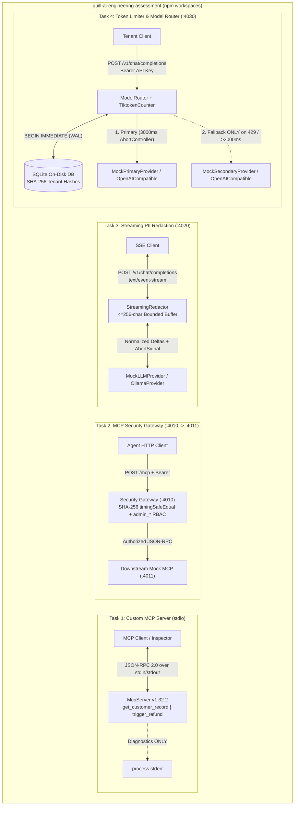

# QuillAI Senior AI Infrastructure & Security Engineering Assessment (`quill-ai-engineering-assessment`)

## 1. Project Overview

`quill-ai-engineering-assessment` is a production-grade **Node.js 24 LTS / strict TypeScript ESM monorepo** implementing four independent AI infrastructure, Model Context Protocol (MCP), real-time guardrail, and LLM gateway systems:

1. **Task 1 (`packages/task-1-mcp-server`)**: Custom MCP Server over `stdio` using official `@modelcontextprotocol/sdk` v1.x with strict Zod validation, deterministic customer/refund tools, and pure JSON-RPC stdout isolation.
2. **Task 2 (`packages/task-2-mcp-security-gateway`)**: HTTP JSON-RPC 2.0 reverse proxy gateway (`:4010`) enforcing SHA-256 constant-time Bearer authentication and role-based tool authorization (`admin_*` tool blocking with JSON-RPC `-32001`) in front of a downstream mock MCP server (`:4011`).
3. **Task 3 (`packages/task-3-llm-streaming-guardrail`)**: OpenAI-compatible SSE streaming proxy (`:4020`) performing real-time stateful PII redaction (Emails, US SSNs, Luhn-validated Credit Cards) across chunk boundaries with $O(1)$ bounded memory (`MAX_HOLD_BUFFER_LENGTH = 256`), backpressure handling, and client disconnect cancellation.
4. **Task 4 (`packages/task-4-model-router`)**: SQLite-backed rolling 60-second sliding-window token rate limiter (`50,000` tokens default quota) and failover LLM router (`:4030`) using atomic `BEGIN IMMEDIATE` transactions in WAL mode with 3,000ms `AbortController` cancellation and failover on HTTP `429` / timeout.

Every service operates deterministically out-of-the-box on `localhost` with zero paid LLM API keys, zero external cloud dependencies, strict input/output validation, comprehensive automated test coverage, and sanitized error boundaries.

---

## 2. Assessment Objectives

Modern enterprise AI deployments require strong protocol boundaries, least-privilege tool governance, real-time sensitive data redaction across streaming token chunks, and atomic multi-tenant cost/rate controls with resilient model failover. This monorepo demonstrates:

- **Protocol Fidelity**: Genuine MCP JSON-RPC 2.0 over `stdio` (`stdout` protocol purity, `-32602` Invalid Params mapping) and HTTP reverse-proxy inspection.
- **Zero-Trust Security Controls**: Constant-time SHA-256 Bearer digest verification (`crypto.timingSafeEqual`), pre-forwarding `admin_*` RBAC enforcement, credential stripping, and sanitized error envelopes.
- **Stateful Streaming Algorithms**: $O(1)$ bounded-memory (`256`-char ceiling) streaming PII redaction across arbitrary chunk splits with backpressure and disconnect cancellation.
- **Transactional Persistence & Resilience**: On-disk SQLite (`WAL` mode + `BEGIN IMMEDIATE`) rolling 60-second sliding-window token budgets paired with `AbortController`-driven primary-to-secondary failover.

---

## 3. Architecture Diagram



---

## 4. Technology Stack

| Layer                | Technology / Package                                                            | Pinned Version                 |
| -------------------- | ------------------------------------------------------------------------------- | ------------------------------ |
| Runtime              | Node.js LTS (ESM `"type": "module"`)                                            | `>=24.0.0`                     |
| Language             | TypeScript (`strict`, `noUncheckedIndexedAccess`, `exactOptionalPropertyTypes`) | `5.9.3`                        |
| Schema Validation    | `zod`                                                                           | `3.25.76`                      |
| Task 1 MCP SDK       | `@modelcontextprotocol/sdk` (deliberately pinned v1.x)                          | `1.32.2`                       |
| HTTP & Streams       | Native `node:http`, Web `fetch`, `AbortController`, Async Generators            | Built-in                       |
| Task 4 Database      | `better-sqlite3` (N-API prebuilt, WAL mode)                                     | `13.0.3`                       |
| Task 4 Tokenizer     | `js-tiktoken` (`cl100k_base`)                                                   | `1.0.21`                       |
| Testing              | `vitest`                                                                        | `3.2.7`                        |
| Linting & Formatting | `eslint` + `typescript-eslint` (`strictTypeChecked`) + `prettier`               | `9.39.5` / `8.72.1` / `3.9.10` |
| Dev Runner & CI      | `tsx` + GitHub Actions (`.github/workflows/ci.yml`)                             | `4.23.15`                      |

---

## 5. Repository Structure

```text
quill-ai-engineering-assessment/
├── .editorconfig
├── .env.example
├── .gitattributes
├── .gitignore
├── .prettierignore
├── .prettierrc.json
├── AGENTS.md
├── README.md
├── eslint.config.js
├── package-lock.json
├── package.json
├── tsconfig.json
├── vitest.config.ts
├── .github/
│   └── workflows/
│       └── ci.yml
├── docs/
│   ├── architecture.md
│   ├── security-considerations.md
│   ├── task-1-design.md
│   ├── task-2-design.md
│   ├── task-3-design.md
│   ├── task-4-design.md
│   └── testing-guide.md
└── packages/
    ├── task-1-mcp-server/
    │   ├── README.md
    │   ├── package.json
    │   ├── tsconfig.build.json
    │   ├── tsconfig.json
    │   ├── src/
    │   │   ├── index.ts
    │   │   ├── server.ts
    │   │   ├── config/logger.ts
    │   │   ├── data/mock-customers.ts
    │   │   ├── schemas/customer.schema.ts
    │   │   ├── schemas/refund.schema.ts
    │   │   ├── services/customer.service.ts
    │   │   └── services/refund.service.ts
    │   └── tests/
    │       ├── customer.test.ts
    │       ├── mcp.integration.test.ts
    │       ├── refund.test.ts
    │       └── schemas.test.ts
    ├── task-2-mcp-security-gateway/
    │   ├── README.md
    │   ├── package.json
    │   ├── tsconfig.build.json
    │   ├── tsconfig.json
    │   ├── src/
    │   │   ├── config.ts
    │   │   ├── downstream-mock.ts
    │   │   ├── gateway.ts
    │   │   ├── index.ts
    │   │   ├── auth/roles.ts
    │   │   ├── auth/token-verifier.ts
    │   │   ├── proxy/authorization-policy.ts
    │   │   ├── proxy/forwarder.ts
    │   │   └── proxy/request-validator.ts
    │   └── tests/
    │       ├── auth.test.ts
    │       ├── authorization.test.ts
    │       ├── jsonrpc.test.ts
    │       └── proxy.integration.test.ts
    ├── task-3-llm-streaming-guardrail/
    │   ├── README.md
    │   ├── package.json
    │   ├── tsconfig.build.json
    │   ├── tsconfig.json
    │   ├── src/
    │   │   ├── config.ts
    │   │   ├── index.ts
    │   │   ├── server.ts
    │   │   ├── middleware/request-validator.ts
    │   │   ├── providers/llm-provider.interface.ts
    │   │   ├── providers/mock-llm.provider.ts
    │   │   ├── providers/ollama.provider.ts
    │   │   ├── streaming/pii-patterns.ts
    │   │   ├── streaming/sse-encoder.ts
    │   │   └── streaming/streaming-redactor.ts
    │   └── tests/
    │       ├── chunk-boundary.test.ts
    │       ├── ollama-provider.test.ts
    │       ├── pii-patterns.test.ts
    │       ├── streaming-redactor.test.ts
    │       └── streaming.integration.test.ts
    └── task-4-model-router/
        ├── README.md
        ├── package.json
        ├── tsconfig.build.json
        ├── tsconfig.json
        ├── src/
        │   ├── config.ts
        │   ├── index.ts
        │   ├── server.ts
        │   ├── database/database.ts
        │   ├── database/schema.sql
        │   ├── errors/gateway-errors.ts
        │   ├── limiter/sliding-window-limiter.ts
        │   ├── limiter/token-counter.ts
        │   ├── providers/mock-primary.provider.ts
        │   ├── providers/mock-secondary.provider.ts
        │   ├── providers/model-provider.interface.ts
        │   ├── providers/openai-compatible.provider.ts
        │   ├── router/fallback-policy.ts
        │   └── router/model-router.ts
        └── tests/
            ├── concurrency.test.ts
            ├── database.test.ts
            ├── fallback.test.ts
            ├── openai-compatible-provider.test.ts
            ├── rate-limiter.test.ts
            ├── router.integration.test.ts
            └── token-counter.test.ts
```

---

## 6. Prerequisites

- **Node.js**: `v24.0.0` or newer (verified on Node.js 24 LTS)
- **npm**: `v10.0.0` or newer
- **Git**: `v2.30+`
- **Zero External Dependencies**: No Docker, Redis, PostgreSQL, or paid API keys required. All services run on local loopback (`127.0.0.1`) with built-in mock providers and an on-disk SQLite WAL database.
- _(Optional)_ **Ollama**: If you wish to demonstrate live local LLM inference in Tasks 3 and 4, install [Ollama](https://ollama.com/) and run `ollama pull llama3.2:1b`.

---

## 7. Installation Instructions

Clone the repository and install locked dependencies from the repository root:

```bash
git clone <repository-url>
cd quill-ai-engineering-assessment
npm ci
npm run build
```

The build command compiles TypeScript project references across all four workspace packages into their respective `dist/` directories and copies the SQLite database schema.

---

## 8. Environment Configuration

All four packages include safe, deterministic local defaults and will start immediately without a `.env` file. To customize ports, log levels, or demo credentials, copy `.env.example`:

```bash
cp .env.example .env
```

> **Security Invariant**: Never commit `.env` to version control. The repository `.gitignore` strictly ignores `.env` and all `.env.*` variants (except `.env.example`). All tokens in `.env.example` are non-secret local demonstration fixtures.

---

## 9. Task 1 Setup and Execution

Task 1 implements a pure Model Context Protocol (MCP) server over `stdio`:

- **Exposed Tools**: `get_customer_record` (`customer_id: ^CUST-[0-9]{5}$`) and `trigger_refund` (`customer_id`, finite `amount > 0`, trimmed `reason >= 10 chars`).
- **Validation**: Strict Zod schemas reject unexpected extra properties with JSON-RPC error `-32602` (`Invalid Params`).
- **Stdio Protocol Purity**: `process.stdout` emits strictly newline-delimited JSON-RPC 2.0 frames; all diagnostic logs are routed exclusively to `process.stderr`.

```bash
# Start Task 1 in development mode (listens on stdin)
npm run dev:task1

# Run Task 1 automated test suite
npm run test:task1
```

---

## 10. Task 2 Setup and Execution

Task 2 implements an HTTP reverse proxy security gateway (`:4010`) and a downstream mock MCP server (`:4011`):

- **Authentication**: `Authorization: Bearer <token>` verified via SHA-256 digests and `crypto.timingSafeEqual`.
- **Tool Authorization**: `tools/list` is forwarded for all authenticated roles. `tools/call` for any tool prefixed with `admin_` (e.g., `admin_reset_key`) requires the `admin` role; `viewer` calls are blocked with JSON-RPC `-32001` before reaching downstream.
- **Sanitized Errors**: Downstream connection failures return sanitized `502 Bad Gateway` envelopes without leaking upstream paths.

```bash
# Start Gateway (:4010) and Downstream Mock (:4011) together
npm run dev:task2

# Run Task 2 automated test suite
npm run test:task2
```

---

## 11. Task 3 Setup and Execution

Task 3 implements an OpenAI-compatible SSE streaming proxy (`:4020/v1/chat/completions`):

- **PII Redaction**: Redacts Email addresses, US Social Security Numbers, and Luhn-validated Credit Card numbers into `[REDACTED]`.
- **Chunk-Split Resilience**: Detects and redacts sensitive patterns even when split across arbitrary chunk boundaries (including 1-character chunks).
- **$O(1)$ Bounded Memory**: Holds at most `MAX_HOLD_BUFFER_LENGTH = 256` characters plus a `1`-character left-boundary tracker; never buffers full responses.
- **Provider Modes**: Defaults to `LLM_PROVIDER=mock`. Supports real local Ollama streaming via `LLM_PROVIDER=ollama` (`http://127.0.0.1:11434/v1`, model `llama3.2:1b`).

```bash
# Start Task 3 streaming gateway (:4020)
npm run dev:task3

# Run Task 3 automated test suite
npm run test:task3
```

---

## 12. Task 4 Setup and Execution

Task 4 implements a SQLite-backed token rate limiter and failover model router (`:4030/v1/chat/completions`):

- **Atomic Quota**: Rolling 60-second window enforcing a default quota of **`50,000` tokens per tenant** in an on-disk WAL-enabled SQLite database (`data/model-router.sqlite`).
- **Atomic Concurrency**: Evaluates rolling usage and inserts `RESERVED` rows inside a single `BEGIN IMMEDIATE` transaction, preventing concurrent bursts from exceeding quota.
- **Failover Routing**: Invokes Primary (`MockPrimaryProvider` or `OpenAICompatibleModelProvider`) with a 3,000ms `AbortController` timeout; fails over to Secondary **exclusively** on HTTP `429` or timeout.
- **Usage Settlement**: Reconciles to actual `usage.total_tokens` (`SETTLED`) on completion; releases reservations (`RELEASED`, `actual_tokens = 0`) on upstream failure.

```bash
# Start Task 4 model router gateway (:4030)
npm run dev:task4

# Run Task 4 automated test suite
npm run test:task4
```

---

## 13. Individual Test Commands

```bash
# Task 1 (Custom MCP Server)
npm run test:task1

# Task 2 (MCP Security Gateway)
npm run test:task2

# Task 3 (LLM Streaming Guardrail)
npm run test:task3

# Task 4 (Model Router & Limiter)
npm run test:task4
```

---

## 14. Complete Verification Command

To run the complete verification pipeline (clean build, strict typecheck, ESLint analysis, Prettier formatting check, and all automated tests across all four workspaces):

```bash
npm run verify
```

To run individual checks across the entire monorepo:

```bash
npm run build           # Compile TypeScript across all workspaces
npm run typecheck       # Strict typecheck (tsc --noEmit) across all workspaces
npm run lint            # ESLint static analysis (strictTypeChecked)
npm run format:check    # Prettier formatting verification
npm test                # Vitest full test run across all packages
```

---

## 15. Example PowerShell Requests

Because Windows PowerShell 5.1 strips unescaped double quotes inside CLI arguments (`curl.exe -d '{...}'`), always pipe request bodies over stdin using `--data-binary "@-"`:

### Task 1: Stdio MCP Protocol Call

```powershell
@'
{"jsonrpc":"2.0","id":1,"method":"initialize","params":{"protocolVersion":"2024-11-05","capabilities":{},"clientInfo":{"name":"pwsh","version":"1.0.0"}}}
{"jsonrpc":"2.0","method":"notifications/initialized"}
{"jsonrpc":"2.0","id":2,"method":"tools/call","params":{"name":"get_customer_record","arguments":{"customer_id":"CUST-12345"}}}
'@ | npm run --silent dev:task1
```

### Task 2: Security Gateway (`tools/call` Admin Tool as Viewer -> `-32001`)

```powershell
@'
{"jsonrpc":"2.0","id":"call-1","method":"tools/call","params":{"name":"admin_reset_key","arguments":{"tenant_id":"tenant-01"}}}
'@ | curl.exe -s -X POST http://127.0.0.1:4010/mcp `
  -H "Content-Type: application/json" `
  -H "Authorization: Bearer viewer-token" `
  --data-binary "@-"
```

### Task 3: Streaming Guardrail with Split PII

```powershell
@'
{
  "model": "quill-mock-gpt",
  "stream": true,
  "mock_scenario": "email_three_chunk",
  "messages": [{"role": "user", "content": "Return synthetic contact"}]
}
'@ | curl.exe -N -X POST http://127.0.0.1:4020/v1/chat/completions `
  -H "Content-Type: application/json" `
  --data-binary "@-"
```

### Task 4: Rate Limiter & Model Router

```powershell
@'
{
  "model": "quill-enterprise-1",
  "max_tokens": 40,
  "messages": [{"role": "user", "content": "Say hello briefly."}]
}
'@ | curl.exe -i -X POST http://127.0.0.1:4030/v1/chat/completions `
  -H "Authorization: Bearer demo-tenant-1" `
  -H "Content-Type: application/json" `
  --data-binary "@-"
```

---

## 16. Example Bash Requests

### Task 1: Stdio MCP Protocol Call

```bash
printf '%s\n' \
  '{"jsonrpc":"2.0","id":1,"method":"initialize","params":{"protocolVersion":"2024-11-05","capabilities":{},"clientInfo":{"name":"bash","version":"1.0.0"}}}' \
  '{"jsonrpc":"2.0","method":"notifications/initialized"}' \
  '{"jsonrpc":"2.0","id":2,"method":"tools/call","params":{"name":"get_customer_record","arguments":{"customer_id":"CUST-12345"}}}' \
  | npm run --silent dev:task1
```

### Task 2: Security Gateway (`tools/call` Admin Tool as Viewer -> `-32001`)

```bash
curl -s -X POST http://127.0.0.1:4010/mcp \
  -H "Content-Type: application/json" \
  -H "Authorization: Bearer viewer-token" \
  -d '{"jsonrpc":"2.0","id":"call-1","method":"tools/call","params":{"name":"admin_reset_key","arguments":{"tenant_id":"tenant-01"}}}'
```

### Task 3: Streaming Guardrail with Split PII

```bash
curl -N -X POST http://127.0.0.1:4020/v1/chat/completions \
  -H "Content-Type: application/json" \
  -d '{"model":"quill-mock-gpt","stream":true,"mock_scenario":"email_three_chunk","messages":[{"role":"user","content":"Return synthetic contact"}]}'
```

### Task 4: Rate Limiter & Model Router

```bash
curl -i -X POST http://127.0.0.1:4030/v1/chat/completions \
  -H "Authorization: Bearer demo-tenant-1" \
  -H "Content-Type: application/json" \
  -d '{"model":"quill-enterprise-1","max_tokens":40,"messages":[{"role":"user","content":"Say hello briefly."}]}'
```

---

## 17. Expected Responses

### Task 1 Successful `get_customer_record` Response

```json
{
  "jsonrpc": "2.0",
  "id": 2,
  "result": {
    "content": [
      {
        "type": "text",
        "text": "{\"customer_id\":\"CUST-12345\",\"name\":\"Elena Vance\",\"email\":\"elena.vance@blackmesa.internal\",\"tier\":\"PLATINUM\",\"total_spend\":18450.75,\"active_orders_count\":3,\"created_at\":\"2024-03-15T08:30:00.000Z\"}"
      }
    ]
  }
}
```

### Task 1 Validation Error (`-32602 Invalid Params`)

```json
{
  "jsonrpc": "2.0",
  "id": 4,
  "error": {
    "code": -32602,
    "message": "MCP error -32602: Invalid arguments for tool \"get_customer_record\": customer_id: customer_id must match format ^CUST-[0-9]{5}$ (e.g., CUST-12345)"
  }
}
```

### Task 2 Blocked Viewer Call (`-32001 Unauthorized Tool Call`)

```json
{
  "jsonrpc": "2.0",
  "id": "call-1",
  "error": {
    "code": -32001,
    "message": "Unauthorized Tool Call"
  }
}
```

### Task 3 Redacted SSE Stream Output

```text
data: {"id":"chatcmpl_mock_01","object":"chat.completion.chunk","created":1769904000,"model":"quill-mock-gpt","choices":[{"index":0,"delta":{"role":"assistant","content":""},"finish_reason":null}]}

data: {"id":"chatcmpl_mock_01","object":"chat.completion.chunk","created":1769904000,"model":"quill-mock-gpt","choices":[{"index":0,"delta":{"content":"Contact "},"finish_reason":null}]}

data: {"id":"chatcmpl_mock_01","object":"chat.completion.chunk","created":1769904000,"model":"quill-mock-gpt","choices":[{"index":0,"delta":{"content":"[REDACTED] regarding the "},"finish_reason":null}]}

data: {"id":"chatcmpl_mock_01","object":"chat.completion.chunk","created":1769904000,"model":"quill-mock-gpt","choices":[{"index":0,"delta":{"content":"request."},"finish_reason":null}]}

data: {"id":"chatcmpl_mock_01","object":"chat.completion.chunk","created":1769904000,"model":"quill-mock-gpt","choices":[{"index":0,"delta":{},"finish_reason":"stop"}]}

data: [DONE]
```

### Task 4 Successful Routed Completion

```json
{
  "id": "chatcmpl_req_...",
  "object": "chat.completion",
  "created": 1769904000,
  "model": "quill-enterprise-1",
  "request_id": "req_...",
  "provider": "mock-primary",
  "routed_via_fallback": false,
  "choices": [
    {
      "index": 0,
      "message": {
        "role": "assistant",
        "content": "Primary model response (quill-enterprise-1): processed \"Say hello briefly.\""
      },
      "finish_reason": "stop"
    }
  ],
  "usage": {
    "prompt_tokens": 8,
    "completion_tokens": 16,
    "total_tokens": 24
  }
}
```

### Task 4 Rate Limit Exceeded (`HTTP 429`)

```json
{
  "error": {
    "code": "RATE_LIMIT_EXCEEDED",
    "message": "Tenant token quota of 50000 tokens per rolling 60s window exceeded.",
    "request_id": "req_...",
    "retry_after_ms": 42150
  }
}
```

---

## 18. Local Development Configuration

| Service                      | Host        | Default Port           | Primary Route               | Default Auth / Identity               |
| ---------------------------- | ----------- | ---------------------- | --------------------------- | ------------------------------------- |
| Task 1 Custom MCP Server     | `stdio`     | N/A (`stdin`/`stdout`) | JSON-RPC 2.0 frames         | Stdio session transport               |
| Task 2 MCP Security Gateway  | `127.0.0.1` | `4010`                 | `POST /mcp`                 | `Bearer admin-token` / `viewer-token` |
| Task 2 Downstream Mock MCP   | `127.0.0.1` | `4011`                 | `POST /mcp`, `GET /health`  | Internal loopback target              |
| Task 3 Streaming PII Gateway | `127.0.0.1` | `4020`                 | `POST /v1/chat/completions` | Unauthenticated open proxy            |
| Task 4 Model Router Gateway  | `127.0.0.1` | `4030`                 | `POST /v1/chat/completions` | `Bearer <any-tenant-id>` (SHA-256)    |

---

## 19. SQLite Persistence Explanation

Task 4 initializes an on-disk SQLite database at `packages/task-4-model-router/data/model-router.sqlite` (ignored by git):

- **Pragmas**:
  - `journal_mode = WAL`: Write-Ahead Logging allows concurrent readers while a single writer commits.
  - `busy_timeout = 5000`: Coordinates write locks across parallel workers/threads for up to 5 seconds.
  - `foreign_keys = ON`: Enforces relational integrity between tenants and ledger rows.
  - `synchronous = NORMAL`: Ensures zero database corruption on process termination with low I/O latency.
- **Relational Schema (`STRICT`)**:
  - `tenants`: Stores `tenant_hash TEXT PRIMARY KEY` (64-char SHA-256 hex digest), `created_at`, `last_seen_at`.
  - `token_usage_ledger`: Stores `id`, `tenant_hash REFERENCES tenants`, `request_id TEXT NOT NULL UNIQUE`, `reserved_tokens INTEGER > 0`, `actual_tokens INTEGER`, `status TEXT CHECK(status IN ('RESERVED', 'SETTLED', 'RELEASED'))`, `created_at`, and `updated_at`.
  - Index: `idx_token_usage_tenant_window ON token_usage_ledger(tenant_hash, status, created_at)`.
- **Atomic Two-Phase Reservation**:
  - `tryReserveTokens`: `BEGIN IMMEDIATE` write transaction evicts expired rows (`created_at <= now - 60s`), checks `active_tokens + reservedTokens <= quotaLimit`, and inserts a `RESERVED` row before the provider is contacted.
  - `settleReservation`: Updates the row to `SETTLED` with actual tokens consumed.
  - `releaseReservation`: Updates the row to `RELEASED` with `actual_tokens = 0` on upstream provider failure.

---

## 20. Security Considerations

1. **Credential Hygiene**: Plaintext bearer tokens and API keys are never persisted to disk or logged. Task 2 hashes tokens in memory and compares digests via `crypto.timingSafeEqual`. Task 4 stores only 64-character SHA-256 digests in SQLite.
2. **Error Envelope Sanitization**: Client error payloads never expose upstream hostnames, internal database schemas, operating system paths, or raw stack traces.
3. **Least-Privilege Tool Execution**: `admin_*` tools are gated at the proxy before reaching downstream MCP servers.
4. **Stream Memory Bounds**: Task 3 enforces a strict `256`-character maximum holdback window, eliminating memory exhaustion attacks on long streaming responses.
5. **Pre-Provider Quota Gating**: Rejected rate-limit requests (`429`) exit before contacting upstream model providers, preventing financial denial-of-wallet exhaustion.

---

## 21. Mock Provider versus Real Provider Configuration

Each task is built to be completely self-contained without requiring paid API credentials or external network access.

### Deterministic Mock Providers (Default for Automated Tests)

- **Task 3 (`MockLLMProvider`)**: Generates deterministic text chunks and supports fault injection via `mock_scenario` (`email_split`, `ssn_split`, `credit_card_split`, `mid_stream_error`).
- **Task 4 (`MockPrimaryProvider` & `MockSecondaryProvider`)**: Support deterministic fault injection (`primary_429`, `primary_timeout`, `primary_500`, `both_unavailable`).
- Default configuration in `.env.example`: `LLM_PROVIDER=mock`.

### Real Local LLM Provider (Optional Ollama Support)

Both Task 3 and Task 4 include native adapters for local Ollama models (`POST /v1/chat/completions`):

- **Task 3 (`OllamaProvider`)**: Real SSE stream parser piping upstream token deltas through `StreamingRedactor`.
- **Task 4 (`OpenAICompatibleModelProvider`)**: HTTP model adapter supporting timeouts, cancellation, and HTTP 429 error mapping.
- To switch to Ollama, update `.env`:
  ```dotenv
  LLM_PROVIDER=ollama
  OLLAMA_BASE_URL=http://127.0.0.1:11434/v1
  OLLAMA_MODEL=llama3.2:1b
  ```
- **Opt-In Live Tests**: Run `OLLAMA_LIVE_TEST=true npm test` to execute live end-to-end streaming and rate-limiting tests against a running local Ollama instance.

---

## 22. Known Limitations

1. **Local Demonstration Authentication**: Task 2 maps static `ADMIN_TOKEN` / `VIEWER_TOKEN` strings for assessment demonstration. Production deployments should verify cryptographically signed OIDC JWTs with audience and issuer verification.
2. **Local Loopback Scope**: Services bind to `127.0.0.1` over HTTP for local evaluation. Production deployments require TLS 1.3 termination and reverse-proxy ingress.
3. **Single-Node SQLite Scope**: Task 4 coordinates concurrency across async requests, worker threads, and local processes sharing the SQLite WAL file. Multi-node distributed clusters require a distributed coordination store (e.g., Redis or PostgreSQL).
4. **Regex/Luhn PII Scope**: Task 3 deterministically redacts structured Emails, US SSNs, and ISO/IEC 7812 Payment Cards. Unstructured entities (such as person names or physical street addresses) require complementary NER model inference.
