# System Architecture Overview

`quill-ai-engineering-assessment` is organized as an **npm workspaces monorepo** containing four strictly isolated AI infrastructure services. Each package models a real-world control point in modern enterprise AI agent and LLM deployments.

## High-Level Monorepo Topology

```mermaid
flowchart TB
  subgraph Monorepo["quill-ai-engineering-assessment (Node.js 24 LTS / TypeScript Strict / ESM)"]
    direction TB

    subgraph T1["Task 1: packages/task-1-mcp-server"]
      C1["MCP Host / Agent Client"] <-->|"stdio (stdout JSON-RPC only)"| S1["McpServer v1.32.2\nStrict Zod Schemas"]
      S1 -.->|"structured JSON logs"| E1["stderr"]
    end

    subgraph T2["Task 2: packages/task-2-mcp-security-gateway"]
      C2["AI Agent HTTP Client"] -->|"POST /mcp + Bearer Token\n(:4010)"| G2["Security Gateway Proxy\nAuthn + admin_* RBAC"]
      G2 -->|"Permitted JSON-RPC (:4011)"| D2["Downstream Mock MCP Server"]
    end

    subgraph T3["Task 3: packages/task-3-llm-streaming-guardrail"]
      C3["Streaming Chat Client"] <-->|"OpenAI SSE (:4020)\nPOST /v1/chat/completions"| G3["Streaming Redactor\nBounded 256-char Lookbehind"]
      G3 <-->|"AsyncIterable Deltas"| P3["LLMStreamProvider\n(Deterministic Mock)"]
    end

    subgraph T4["Task 4: packages/task-4-model-router"]
      C4["Tenant Application"] -->|"POST /v1/chat/completions\nBearer API Key (:4030)"| G4["Model Router & Rate Limiter"]
      G4 <-->|"BEGIN IMMEDIATE (WAL)"| DB4[("SQLite On-Disk DB\nSHA-256 Tenant Ledger")]
      G4 -->|"1. Primary (3000ms Abort)"| MP["MockPrimaryProvider"]
      G4 -.->|"2. Failover on 429 / Timeout"| MS["MockSecondaryProvider"]
    end
  end
```

## Shared Engineering Principles

1. **Zero Cross-Package Coupling**: None of the four packages import code from sibling packages. Each owns its runtime entrypoint (`src/index.ts`), configuration, domain logic, and test suite.
2. **Native Node.js 24 Primitives**: Gateways use `node:http`, `node:crypto`, Web `fetch`, `AbortController`, and async iterators without heavy web framework overhead.
3. **Deterministic Local Execution**: Every service operates completely offline with deterministic mock providers and seeded synthetic fixtures—no paid LLM API keys or cloud accounts are needed.
4. **Defense-in-Depth Input & Output Controls**:
   - Bounded HTTP request body readers (`413 Payload Too Large`)
   - Explicit `Content-Type` enforcement (`415 Unsupported Media Type`)
   - Strict Zod object schemas (`.strict()`) rejecting unexpected fields
   - Sanitized client-facing error envelopes that strip stack traces, file paths, and internal hostnames.
