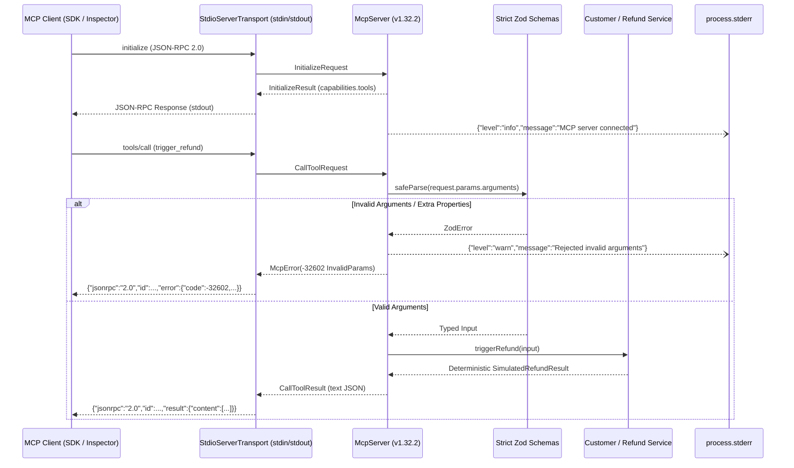

# Task 1 Design: Custom MCP Server with Strict Validation and Stdio Transport

## Protocol & Transport Flow

## Key Engineering Decisions

### 1. Official `@modelcontextprotocol/sdk` v1.x Selection & `-32602` Mapping

We pin `@modelcontextprotocol/sdk@1.32.2` (the v1.x package line, deliberately avoiding the split v2 packages) alongside `zod@3.25.76`.

- Tools are registered via `mcpServer.registerTool(...)` passing constructed `.strict()` `ZodObject` schemas (`GetCustomerRecordSchema` and `TriggerRefundSchema`), which causes `tools/list` to emit JSON Schemas with `"additionalProperties": false`.
- **SDK v1.25+ / SEP-1303 Nuance**: Starting in late v1.x releases of `@modelcontextprotocol/sdk`, `McpServer`'s default `CallToolRequestSchema` wrapper catches `McpError(ErrorCode.InvalidParams)` and wraps it into an application-level `{ isError: true }` tool result, and also coerces `arguments ?? {}`. To honor the assessment's strict protocol requirement that malformed tool inputs map to standard JSON-RPC **Invalid Params (`-32602`)**—and to reject `undefined`/`null` argument payloads—we install a `CallToolRequestSchema` handler via the SDK's documented `mcpServer.server.setRequestHandler(...)` hook. It validates raw `request.params.arguments` directly against our `.strict()` Zod schemas and throws `new McpError(ErrorCode.InvalidParams, ...)`.

### 2. Strict Stdio Isolation

MCP stdio framing parses newline-delimited JSON-RPC messages from `stdout`. Any stray `console.log()` corrupts client framing.

- `eslint.config.js` enforces `'no-console': 'error'` across `packages/task-1-mcp-server/src/**/*.ts`.
- `createStderrLogger` writes structured JSON lines exclusively via `process.stderr.write(...)`.
- Subprocess integration tests inspect every line emitted on `stdout` to prove 100% JSON-RPC 2.0 purity.
