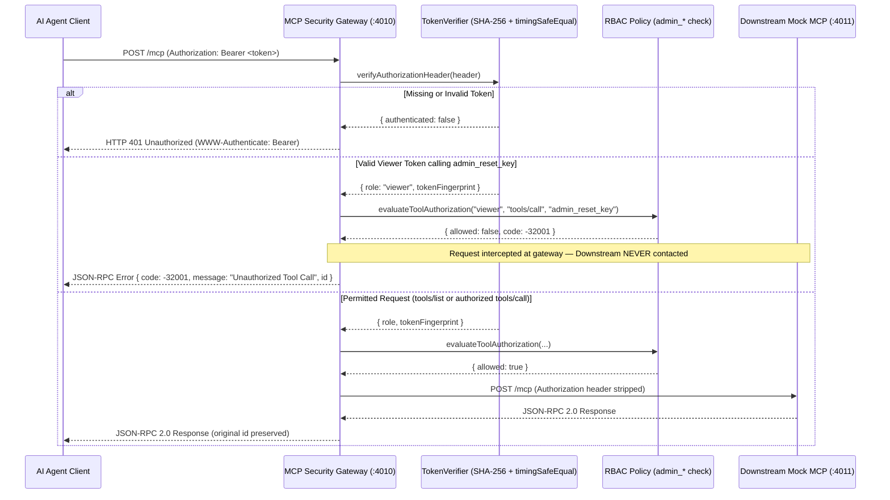

# Task 2 Design: MCP Security Gateway Proxy

## Request Inspection & Authorization Pipeline

## Key Design Decisions

1. **Constant-Time Digest Comparison & Zero Plaintext Retention**:
   `TokenVerifier` immediately hashes configured `ADMIN_TOKEN` and `VIEWER_TOKEN` strings with SHA-256 at startup and discards the plaintext values. Incoming Bearer tokens are hashed with SHA-256 and compared against all role entries using `crypto.timingSafeEqual` without short-circuiting, preventing length-oracle timing attacks and guaranteeing plaintext credentials never appear in memory dumps or structured audit logs.
2. **Explicit Batch Rejection Policy**:
   JSON-RPC 2.0 batch arrays (`[...]`) are explicitly rejected with `-32600 Invalid Request` (HTTP `400`). Supporting mixed-privilege batches introduces partial-execution ambiguity and audit-log smuggling risks; enforcing 1:1 HTTP-to-JSON-RPC request framing guarantees atomic per-call authorization auditing.
3. **Notification Preservation**:
   JSON-RPC notifications (requests omitting `id`) never receive a fabricated response ID. Unauthorized notifications are dropped at the gateway with `204 No Content`, and permitted notifications are forwarded downstream returning `204 No Content`.
4. **Credential Stripping & Error Sanitization**:
   `DownstreamForwarder` strips the client's `Authorization` header before forwarding downstream (substituting non-secret `X-Request-Id` and `X-Authenticated-Role` headers) and maps downstream timeouts (`504`) and crashes/connection refusals (`502`) to clean JSON-RPC error envelopes (`-32003` / `-32002`).
