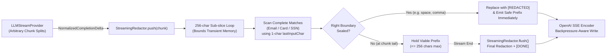

# Task 3 Design: Stateful Streaming PII Redaction Gateway

## Streaming State Machine & Bounded Look-Behind Architecture

## Maximum Pattern Lengths & Buffer Sizing Math

To guarantee **zero partial PII leakage** without accumulating entire completions in memory, we define explicit upper bounds for every supported pattern:

| PII Category            | Structural Rule                                  | Maximum Length | Reasoning                                                                                                                                       |
| ----------------------- | ------------------------------------------------ | -------------- | ----------------------------------------------------------------------------------------------------------------------------------------------- |
| **Email Address**       | `local@domain.tld`                               | **254 chars**  | RFC 5321/5322 practical ceiling (`64`-char local part + `@` + `189`-char domain).                                                               |
| **Credit / Debit Card** | 13–19 digits + uniform `' '` or `'-'` separators | **23 chars**   | ISO/IEC 7812 max 19 PAN digits + up to 4 group separators; validated with Luhn checksum (or standard 15/16-digit MII `[3-6]` group formatting). |
| **US SSN**              | `DDD-DD-DDDD`, `DDD DD DDDD`, or `DDDDDDDDD`     | **11 chars**   | SSA area (`001–899 \ {666}`), group (`01–99`), and serial (`0001–9999`) validation.                                                             |
| **Holdback Ceiling**    | `MAX_HOLD_BUFFER_LENGTH`                         | **256 chars**  | `254` (max email) + `2` characters of right-boundary lookahead margin, plus `1`-character `lastInputChar` left-boundary context.                |

## Latency vs. Safety Trade-Offs

- **Zero-Wait Safe Prose**: Ordinary prose tokens ending in whitespace or punctuation that cannot begin an email or numeric PII sequence (e.g., `"Hello! For billing support, "`) have `holdIndex === buffer.length` and flush on the **exact same tick** they arrive ($0\text{ ms}$ added buffering latency).
- **Minimal Holdback on Candidate Prefixes**: Only tokens that form a syntactically valid prefix of an email local-part/domain (e.g., `"john@"`, `"gmail."`) or digit sequence (e.g., `"4111 "`, `"123-"`) are held until a non-continuing delimiter arrives (or `flush()` runs at stream completion).
- **Right-Boundary Extension Safety**: Complete matches touching the end of the pending buffer (e.g., `"john@gmail.co"` before `"m"` or `".uk"`, or 9 digits `"411111111"` before the remaining 7 digits of a 16-digit Visa card) are held until a sealing delimiter arrives, preventing premature partial redactions like `"[REDACTED]m"` or `"[REDACTED]1111111"`.
- **$O(1)$ Memory Invariant**: Even on multi-megabyte streams or pathological continuous text without spaces, `StreamingRedactor` slices incoming deltas in `256`-character increments and enforces `minAllowedHoldIndex = max(0, len - 256)`, keeping memory strictly $O(1)$.
