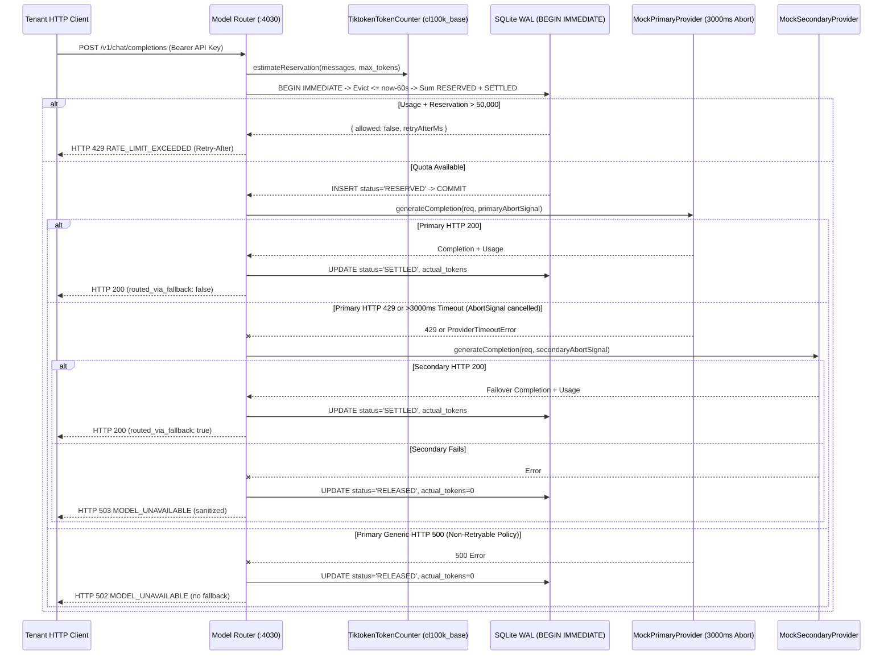

# Task 4 Design: SQLite Sliding-Window Token Rate Limiter & Model Failover Router

## Atomic Reservation & Failover Sequence

## Key Architectural Invariants

1. **Why `BEGIN IMMEDIATE` Prevents Race Conditions**:
   Under SQLite's default `DEFERRED` transaction mode, two concurrent connections can both read `SUM(tokens) = 30,000` before either attempts an `INSERT`, allowing two `30,000`-token requests (`60,000 > 50,000`) to race or fail with `SQLITE_BUSY` mid-transaction. Executing `reserveAtomicTx.immediate(...)` issues `BEGIN IMMEDIATE`, acquiring SQLite's RESERVED write lock _before_ calculating active window usage (`busy_timeout = 5000` coordinates contention cleanly across connections and worker threads).
2. **SHA-256 Tenant Isolation**:
   API keys from `Authorization: Bearer <key>` are immediately hashed using SHA-256 (`64` lowercase hex characters) and enforced via `CHECK (length(tenant_hash) = 64)` in SQLite `STRICT` tables. Raw credentials never touch disk or logs.
3. **Reservation Reconciliation & Abandoned TTL**:
   - Pre-flight reservation reserves `promptTokens + max_tokens` using server-side `js-tiktoken` (`cl100k_base`).
   - On completion, `SETTLED` reconciles downward/upward to `provider.usage.totalTokens` (or a conservative local BPE estimate `promptTokens + max(1, countText(output))` when provider usage is absent).
   - On upstream failure, `RELEASED` sets `actual_tokens = 0` so upstream outages do not consume tenant quota. Stale `RESERVED` rows older than `staleReservationTtlMs` (`120s`) are automatically swept on subsequent reservations to handle abrupt process crashes.
4. **Cancellation-Safe Failover**:
   Primary timeout uses an `AbortController` timer that cancels the in-flight primary operation immediately at `3,000ms` rather than orphaning background promises via bare `Promise.race`.
